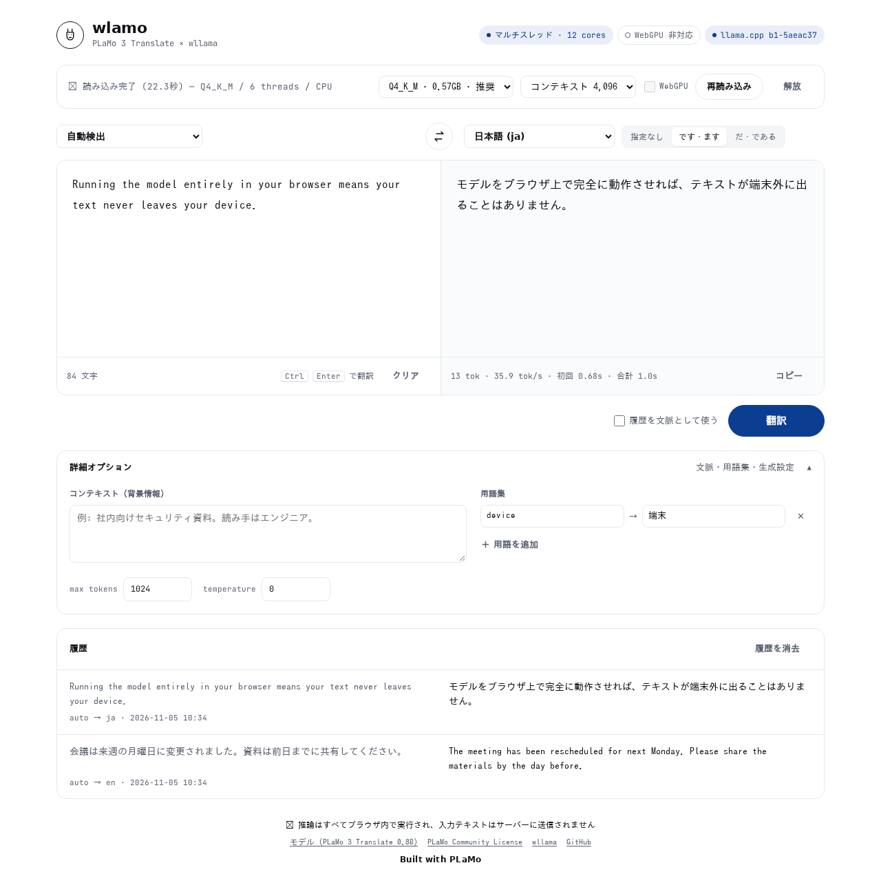
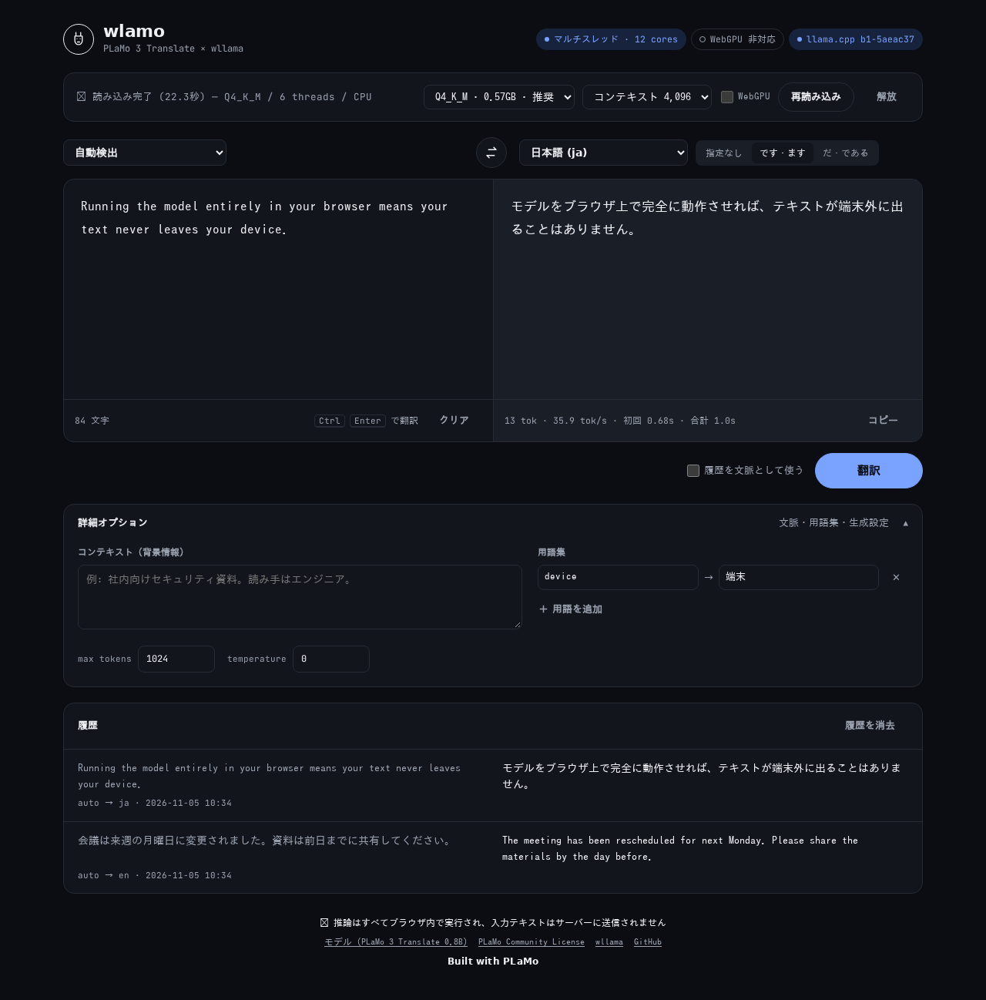
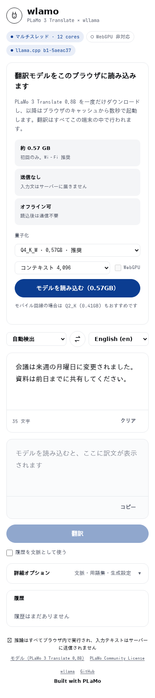

# wlamo 🦙

Preferred Networks の **PLaMo 3 Translate 0.8B** を [wllama](https://github.com/ngxson/wllama) (llama.cpp の WebAssembly 版) で **ブラウザ内だけで** 動かす翻訳アプリです。配信は Cloudflare Workers (Static Assets)。



<p> </p>

UI デザインは Claude Design で作成したモックを元に実装しています。

- 推論はすべてクライアント側 (WASM / マルチスレッド / 対応環境では WebGPU)。入力テキストはサーバーに送られません
- モデル: [`pfnet/plamo-3-translate-0.8b-GGUF`](https://huggingface.co/pfnet/plamo-3-translate-0.8b-GGUF) を Hugging Face から直接取得し、ブラウザのキャッシュ (OPFS) に保存。2回目以降はオフラインでも読み込み可
- 量子化 Q4_K_M / Q4_0 / Q3_K_M / Q2_K を選択可能
- 53 言語 + やさしい日本語、文体指定 (です・ます / だ・である)、コンテキスト、用語集、翻訳履歴を文脈として利用
- プロンプトは公式 `chat_template.jinja` と同等の PFML3 を [`src/pfml.ts`](src/pfml.ts) で組み立て、`createCompletion` でストリーミング生成

## 構成

| パス | 役割 |
| --- | --- |
| `src/` | UI (Vite + TypeScript, フレームワークなし) |
| `worker/index.ts` | Cloudflare Worker。静的アセット配信 + `COOP/COEP` ヘッダ付与 (SharedArrayBuffer → マルチスレッド WASM に必須) |
| `wrangler.jsonc` | Workers 設定 (`assets.run_worker_first: true`) |
| `vendor/wllama/` | wllama のカスタムビルド (下記) |

### なぜ wllama を vendoring しているか

npm の `@wllama/wllama@3.8.1` (2026-10-02) が同梱する llama.cpp は PLaMo 3 トークナイザ対応 ([llama.cpp#30045](https://github.com/ggml-org/llama.cpp/pull/30045), 2026-10-06) より古く、`unknown tokenizer: 'plamo3'` で読み込みに失敗します。そのため wllama master (llama.cpp `5aeac37`) から WASM をビルドして `vendor/wllama` に同梱しています。Safari 向けの compat ビルド (Asyncify) も自前ホストしています。
新しい wllama が npm に出たら `package.json` を差し替えるだけで vendor は不要になります。再ビルドは `scripts/build-wllama.sh`。

## 開発

```bash
npm install
npm run dev        # Vite dev server (COOP/COEP 付き)
npm run preview    # build して wrangler dev で Workers 上の挙動を確認
npm run deploy     # Cloudflare Workers にデプロイ (wrangler login が必要)
```

WASM は 9.2MB / compat 16.8MB で Workers Static Assets の 1 ファイル上限 (25MiB) に収まります。

## 動作確認 (headless Chromium, CPU 6 threads)

| | 結果 |
| --- | --- |
| ja→en | The meeting has been rescheduled for next Monday. Please share the materials by the day before. (≈40 tok/s) |
| en→ja | 会議は来週の月曜日に変更になりました。 |

## ライセンス

- このリポジトリのコード: MIT
- wllama: MIT (`vendor/wllama/LICENCE`)
- PLaMo 3 Translate モデル: [PLaMo Community License](https://plamo.preferredai.jp/info/plamo-community-license)。モデルは本リポジトリに含まれず、利用者のブラウザが Hugging Face から直接ダウンロードします。商用利用には PFN への登録が必要です。

Built with PLaMo
